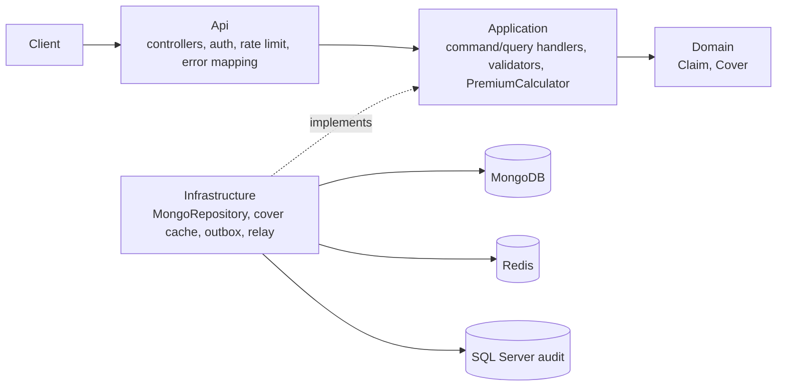
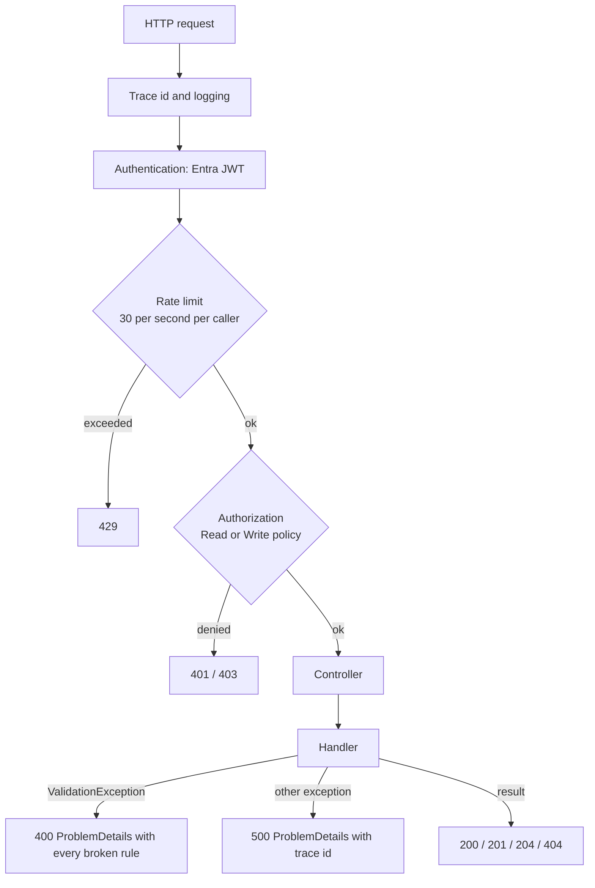
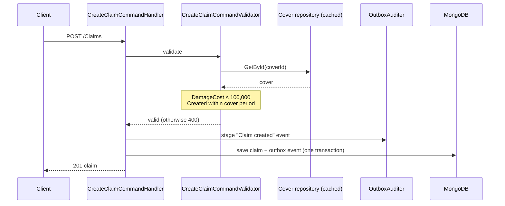
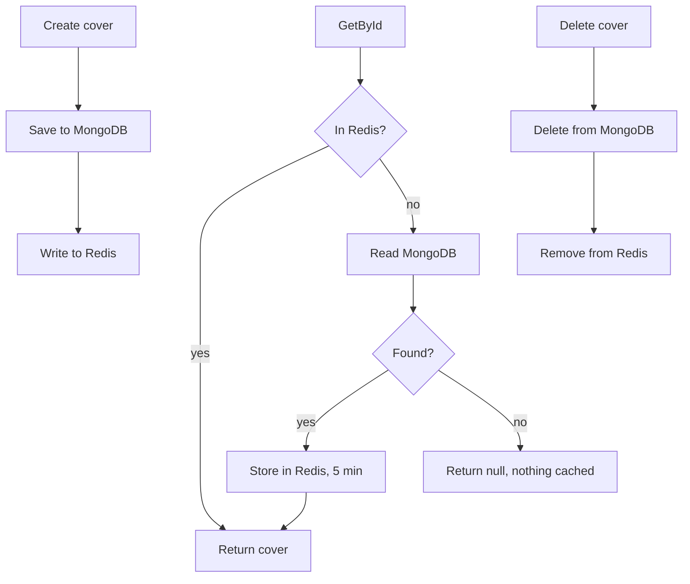
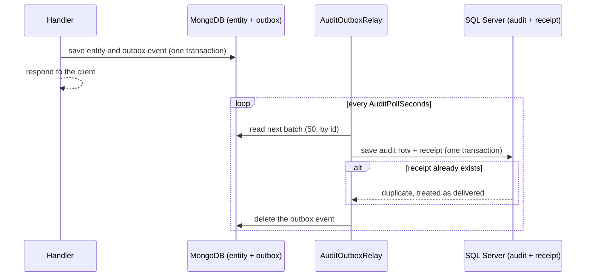

# Flows

How a request travels through the code. The diagrams are [Mermaid](https://mermaid.js.org) and render on GitHub.
Design decisions and trade-offs are in [SOLUTION.md](SOLUTION.md).

## Layers

Dependencies point inwards: `Api` and `Infrastructure` know `Application`, which knows `Domain`.
`Application` defines the interfaces (`IRepository<T>`, `IAuditer`) that `Infrastructure` implements.

| Where | What to read |
|---|---|
| `Api/Controllers` | Thin: bind input, call one handler, map the result to HTTP |
| `Application/Claims`, `Application/Covers` | One handler per use case, plus its command/query and validator |
| `Application/Covers/PremiumCalculator.cs` | The tiered premium rules |
| `Infrastructure/Persistence` | `EfRepository<T>` (MongoDB) and `CachedCoverRepository` (Redis decorator) |
| `Infrastructure/Auditing` | `OutboxAuditer` stages events; `AuditOutboxRelay` delivers them to SQL |

## Request pipeline

## Create a claim

The validator needs the cover, which comes from the cache when possible.

## Create or delete a cover (cache)

The cover cache is rebuilt on every change, so it never serves a deleted cover.

If Redis fails or times out (500 ms), the error is logged as a warning and the database is used instead.

## Auditing: outbox and relay

The HTTP request only writes to MongoDB. The audit event is saved in the same transaction as the change, so
it cannot be lost or exist without the change. `AuditOutboxRelay` copies it to SQL Server in the background.

Failure behaviour:

| Failure | Result |
|---|---|
| SQL unavailable | Event stays in the outbox, error logged, retried on the next scan |
| Crash after the SQL write, before the outbox delete | Event is relayed again; the receipt makes it a skipped duplicate |
| Two instances relay the same event | One SQL insert wins, the other is a skipped duplicate |
| One event keeps failing | It is skipped within the scan so it cannot block later events |

## Premium calculation

`PremiumCalculator.Calculate` multiplies the base day rate (1250) by the vessel multiplier, then prices the days
tier by tier.

| Days | Yacht discount | Other types discount |
|---|---|---|
| 1–30 | none | none |
| 31–180 | 5% | 2% |
| 181 and later | 8% | 3% |

Vessel multipliers: Yacht 1.1, Passenger ship 1.2, Tanker 1.5, other 1.3.
